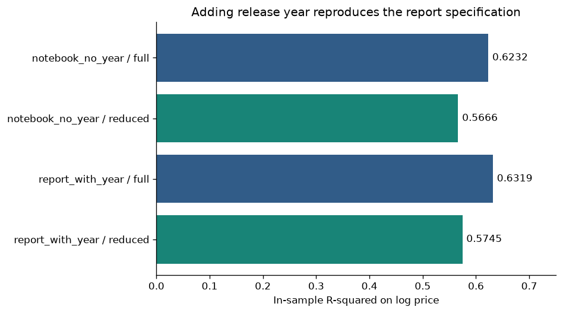
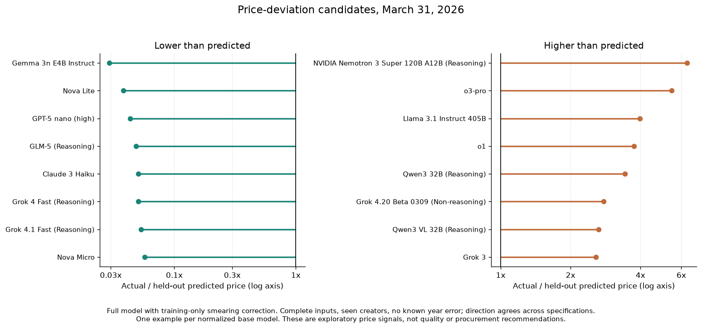

# LLM API Pricing: Reproduction and Individual Extension

## Key takeaways

- **Question:** Which model features are linked to higher or lower LLM API prices?
- **Main finding:** In this March 2026 sample, higher capability scores and more parameters are linked to higher prices. Models labeled open-source and models with faster output are linked to lower prices. These are correlations, not proof of cause and effect.
- **Prediction limits:** For models left out of training, R² was 0.41 on log prices. The model captures some pricing patterns, but individual price predictions can still be far off.
- **Business use:** Compare actual and predicted prices to shortlist models worth testing for a specific task. This is a price signal, not a quality ranking.

**Research question:** Which observable model characteristics are associated with paid LLM API prices?

This project reconciles a course notebook with its presentation, then examines collinearity, residuals, robust uncertainty, and held-out price predictions. All findings describe associations within a historical sample. They do not identify causes of pricing or establish model quality.

Read the one-page summaries: [English](outputs/summary_en.pdf) | [中文](outputs/summary_zh.pdf).

## Data

The input is version 1 of [Kanchana1990's LLM Price-Performance Tracker](https://www.kaggle.com/datasets/kanchana1990/llm-price-performance-tracker-march-2026), collected on March 31, 2026: **453 records and 34 columns**. Removing 138 missing prices and 16 zero prices leaves **299 positive-price records**. The outcome is the supplied blended API price in USD per one million tokens; its exact blending weights have not been independently verified.

The source column `provider` means the model creator or developer, not necessarily the inference API service selling access. Parameter counts, release years, and openness classifications contain curated metadata without row-level verification. Known Claude 4.6 release-year errors are preserved in the reproduction and excluded from the candidate shortlist.

Kaggle declares the dataset **CC0: Public Domain**. Upstream redistribution rights have not been independently verified, so the raw CSV is excluded from this repository. This does not establish infringement or automatically apply current Artificial Analysis API terms to the historical Kaggle download. See [data sources, checksums, and limitations](data/README.md).

The [official Kaggle metadata](https://www.kaggle.com/api/v1/datasets/view/kanchana1990/llm-price-performance-tracker-march-2026) contained only version 1 when checked on October 28, 2026. No later snapshot was found in this exact dataset. A current-data rerun is therefore omitted; these are not current market prices.

## Original course work and individual extension after the course

The original UW IS 451 group project ran from April to June 2026 and received **The Most Trendy Technology Award**. My original contributions were screening the dataset from 453 records to 299 paid-model records and writing the initial regression notebook, including full and reduced models without release year. This repository is an independently rewritten **individual extension after the course**, including reproduction, statistical diagnostics, grouped validation, and new summaries. It does not present the entire group project as solo work, and it does not republish the original presentation or other members' code.

## Methods

1. Reproduce the supplied notebook's OLS models of natural-log price, using median imputation, an openness indicator, and creator dummy variables. The reduced model retains terms with conventional full-model p-values below 0.05 in a single selection step.
2. Reconstruct the presentation's specification by adding release year. Compare its fit and displayed coefficients with the notebook and slides. Log price was already part of the course project, so it is not claimed as a new extension.
3. Inspect VIF, residual patterns, heteroskedasticity, leverage, and influence. Preserve the original models even where HC3 standard errors cannot be calculated reliably.
4. Fit an extension that pools creators with fewer than five training records into an Other group, allowing valid HC3 estimates. Five is a fixed analysis choice, not a tuned threshold. Also fit a specification excluding release year and parameter count.
5. Use five-fold grouped validation across **198 normalized base-model groups**, keeping related effort variants in the same fold. Imputation, creator pooling, feature selection, and the log-to-price smearing correction are estimated within training folds only. The full extension is the predeclared price-deviation model, rather than a model chosen for winning validation metrics.

The full report specification includes intelligence, output speed, first-token latency, first-answer latency, parameter count, release year, the openness indicator, creator indicators, and an intercept.

An appendix also fits price directly with the report-aligned predictors. R² values for price and log price refer to different outcomes and cannot be used as a direct accuracy ranking.

## Reproduction findings

| Specification | Full-model R² | Reduced-model R² | Reduced adjusted R² | Reduced predictors |
|---|---:|---:|---:|---:|
| Supplied notebook, without year | 0.623230 | 0.566571 | 0.540350 | 17 |
| Presentation reconstruction, with year | 0.631892 | 0.574544 | 0.555137 | 13 |
| Extension with pooled creators | 0.567457 | 0.515093 | 0.499992 | 9 |

All rows use the same 299 paid records. The reconstructed reduced result, **R² = 0.574543811 and adjusted R² = 0.555137037**, rounds to the presentation's **0.575 and 0.555**. The notebook omitted release year and produces a different reduced result. Page 12 of the presentation separately shows approximately 0.574; the supplied material does not establish the source of that displayed difference.

The reported effects also reconcile after accounting for scale: intelligence **+0.28**, parameter count **+0.26**, release year **-0.33**, and output speed **-0.74** are changes in log price per one standard deviation of the continuous predictor within this sample (`ddof=0`). The openness coefficient **-1.36** is a binary change from 0 to 1, not a one-standard-deviation change. See the [coefficient reconciliation](outputs/tables/report_coefficient_check.csv) and [model comparison](outputs/tables/model_comparison.csv).



## Diagnostics and inference

The presentation-aligned full model has a maximum VIF of **15.04**, versus **1.81** in its reduced model. This indicates that some full-model coefficients are difficult to separate, rather than showing that the underlying variables are unimportant.

Residual diagnostics flag heteroskedasticity and departures from normality. Some original creator categories have leverage equal to one, making HC3 unavailable for the original full and reduced fits. The pooled extension removes that numerical problem, but changes the specification, so it is reported separately rather than used to overwrite the reproduction.

In the pooled full model, intelligence and parameter count remain positively associated with log price; output speed, release year, and the open-weight indicator remain negatively associated. Their HC3 95% intervals exclude zero. Those intervals and p-values are exploratory, are not adjusted for multiple comparisons, and do not account for all uncertainty introduced by feature selection or metadata quality. HC3 changes uncertainty estimates, not OLS coefficients or R².

See [robust coefficients](outputs/tables/coefficients_extension_pooled_full.csv), [residual diagnostics](outputs/figures/residual_diagnostics.png), and [VIF results](outputs/tables/vif_extension_pooled_full.csv).

## Held-out performance and price-deviation candidates

Metrics pool each record's out-of-fold prediction once. Price errors are in USD per one million tokens; log errors use natural-log units.

| Model | Log MAE | Log RMSE | Price MAE | Price RMSE | Out-of-fold log R² |
|---|---:|---:|---:|---:|---:|
| Full extension | 0.9020 | 1.1869 | 3.8003 | 16.3940 | 0.4092 |
| Reduced extension | 0.9268 | 1.2243 | 3.6010 | 16.0541 | 0.3713 |
| Without year and parameter count | 0.8922 | 1.1956 | 3.7640 | 16.2492 | 0.4004 |
| Training-mean baseline | 1.2361 | 1.5498 | 4.4427 | 16.4168 | -0.0074 |

The full model improves log-scale errors over the baseline, while the reduced model has lower dollar MAE. Removing year and parameter count gives slightly lower log MAE. There is no single winner across metrics, and the full model's dollar RMSE remains close to the simple baseline, so large pricing errors remain material. This is one grouped split, not evidence of stability across repeated splits, future dates, or new creators. See [validation metrics](outputs/tables/cv_metrics.csv) and [error comparison](outputs/figures/cross_validation_errors.png).

The shortlist uses actual price divided by the full model's held-out, smearing-adjusted price prediction. **160 records** have complete predictors, a creator observed in their training fold, and no flagged Claude 4.6 year error. **141** remain on the same side of predicted price across all three extension specifications. The figure shows one example per normalized base model after this agreement check.

Gemma 3n E4B Instruct, Nova Lite, and GPT-5 nano appear below their model-predicted prices; NVIDIA Nemotron 3 Super and o3-pro appear above them. These are candidates for task-specific evaluation, not quality rankings, fair-value estimates, savings guarantees, or procurement recommendations. Missing features, creator pooling, metadata errors, and large prediction errors can all affect the ordering.



The [selection map](outputs/figures/business_selection_map.png) places this historical price signal beside benchmark score and output speed. A practical next step is to test a small shortlist on the intended workload, including accuracy, latency, and the current billable token mix.

## Run

Use Python 3.13. From the repository root:

```bash
python3.13 -m venv .venv
source .venv/bin/activate
python -m pip install -r requirements.txt
python src/download_data.py
python src/run_analysis.py
python src/check_results.py
```

The download checks the pinned snapshot's checksum. The analysis regenerates tables and charts, and the checks verify saved results and validation safeguards. To rebuild the one-page PDFs, run `python src/build_summaries.py`. Open [notebooks/analysis.ipynb](notebooks/analysis.ipynb) with the same environment for a step-by-step explanation.

```text
data/          Source documentation, manifest, local raw-data download
src/           Readable preparation, regression, validation, and checks
notebooks/     Walkthrough of the independently rewritten analysis
outputs/       Generated tables, charts, and bilingual one-page summaries
```

Code is released under the MIT license. Source data retains its own terms; the code license does not relicense it.
